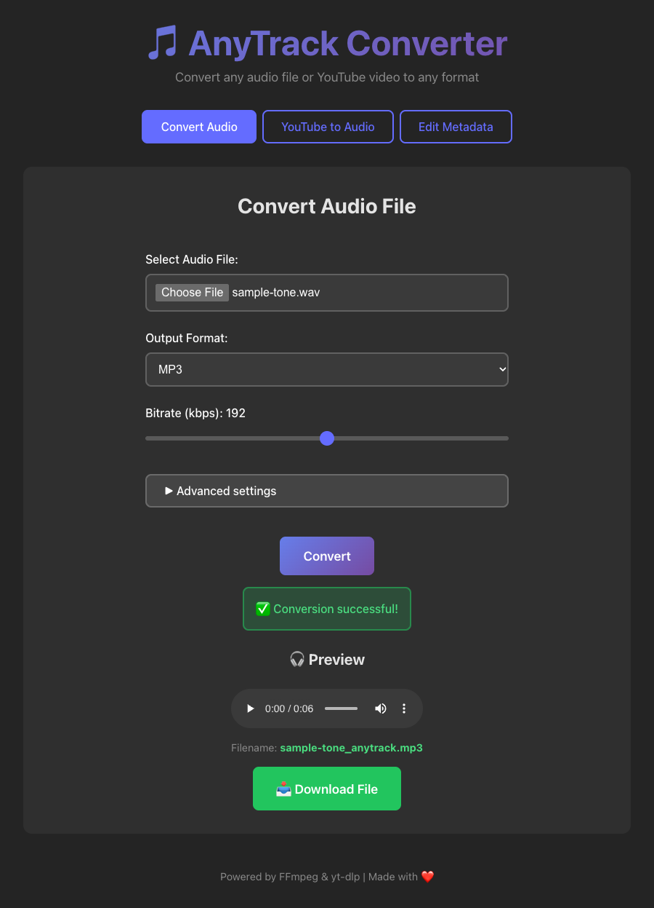

# AnyTrack Converter

[](https://github.com/mbianchidev/anytrack-converter/actions/workflows/ci.yml)
[](LICENSE)

[Quickstart](#quickstart) | [Documentation](docs/README.md) | [Report a bug](.github/ISSUE_TEMPLATE/bug_report.md) | [Request a feature](.github/ISSUE_TEMPLATE/feature_request.md)



*The current app after a real conversion of a six-second synthetic tone. No personal recordings or mocked conversion results are shown.*

AnyTrack Converter is a self-hosted web app for converting audio, extracting audio from YouTube videos, and updating audio metadata. Process your files on your own machine instead of uploading them to a third-party conversion service.

It is intended for single-user, local or trusted-network use, not as a public conversion service. There are no accounts, cloud storage, or background job queues.

## Contents

- [Quickstart](#quickstart)
- [Why AnyTrack Converter](#why-anytrack-converter)
- [How it works](#how-it-works)
- [Get started and configuration](#get-started-and-configuration)
- [Features](#features)
- [Documentation](#documentation)
- [AI policy](#ai-policy)
- [Contributing](#contributing)
- [Security](#security)
- [License](#license)

## Quickstart

Use macOS, Linux, or WSL2 with Git, current stable Rust/Cargo, Node.js 24+ or 22.13+ within the 22.x line, FFmpeg, and yt-dlp installed. The media tools must be on the backend's `PATH`; see [platform installation instructions](docs/README.md#native-development-setup).

Clone the source and start the API:

```bash
git clone https://github.com/mbianchidev/anytrack-converter.git
cd anytrack-converter/backend
cargo run --release
```

In a second terminal, from the cloned repository:

```bash
cd frontend
npm ci
npm run dev
```

Open **http://localhost:3000**, select a file in **Convert Audio**, keep MP3 selected, then select **Convert**. A successful request shows the preview and **Download File** button pictured above.

The API health check should return `{"status":"healthy","version":"0.1.0"}`:

```bash
curl --fail http://localhost:8080/health
```

**Docker users:** the current ARM64 backend image can build but fail to start because of a glibc mismatch. Use the native path above or read the [Docker setup and limitation](docs/README.md#docker-compose-setup).

## Why AnyTrack Converter

- **Keep uploads under your control:** audio processing happens on the machine hosting your API.
- **Use one interface:** convert files, extract YouTube audio, and edit common tags without separate command-line workflows.
- **Choose a small deployment:** there is no account service or database to operate. The tradeoff is local storage maintenance and no multi-user isolation.

YouTube extraction still contacts the source service through yt-dlp. Only convert content you have permission to use.

## How it works

The [React](https://react.dev/)/[Vite](https://vite.dev/) interface calls a Rust/[Actix-web](https://actix.rs/) API. The API stores uploads locally and runs [FFmpeg](https://ffmpeg.org/) for conversion or metadata updates; [yt-dlp](https://github.com/yt-dlp/yt-dlp) downloads YouTube media before audio extraction.

Successful requests return a file ID for browser preview and download. Generated files remain on disk until you remove them. Processing runs inside the request, not in a job queue; see the [architecture and development guide](docs/README.md#development-and-project-layout).

## Get started and configuration

The browser uses `http://localhost:8080` by default. Set `VITE_API_URL` when starting Vite or building the frontend to change it; changing the static container's runtime environment does not rebuild its JavaScript.

| Task | Guide |
| --- | --- |
| Install media tools and run from source | [Native setup](docs/README.md#native-development-setup) |
| Build containers and understand their current limitation | [Docker Compose setup](docs/README.md#docker-compose-setup) |
| Configure the API URL and understand storage/network defaults | [Configuration](docs/README.md#configuration) |
| Use conversion, YouTube extraction, and metadata editing | [User workflows](docs/README.md#use-the-app) |
| Call the API directly or diagnose failures | [API reference](docs/README.md#api) and [troubleshooting](docs/README.md#troubleshooting) |

## Features

- **Audio conversion:** upload audio readable by your FFmpeg installation and export MP3, WAV, FLAC, OGG, AAC, or M4A.
- **YouTube extraction:** submit a video URL and download its audio in one of the same six formats.
- **Conversion controls:** adjust lossy bitrate, MP3 constant/variable bitrate, sample rate, mono/stereo channels, fade-in, and reverse playback for uploaded files.
- **Metadata editing:** update artist, title, album, and genre without re-encoding the audio, where the file format supports those tags.
- **Preview and download:** listen where the browser supports the codec, then save `<normalized-name>_anytrack.<format>`.

See [known limitations](docs/README.md#limitations-and-deployment-safety) for codec support, simulated progress, fade-out behavior, and cleanup.

## Documentation

The [documentation index](docs/README.md) covers user setup, configuration, API examples, troubleshooting, architecture, and developer quality checks. For help, read [SUPPORT.md](SUPPORT.md) or [open an issue](https://github.com/mbianchidev/anytrack-converter/issues).

## AI policy

You are responsible for everything you contribute, including AI-assisted code, documentation, and assets. Review and test your contribution. You must be able to explain what the code does and why it is needed.

## Contributing

Contributions are welcome. Read [CONTRIBUTING.md](CONTRIBUTING.md) and the [Code of Conduct](CODE_OF_CONDUCT.md). Coding agents must also read [AGENTS.md](AGENTS.md) before editing.

## Security

See [SECURITY.md](SECURITY.md) for the existing security policy and [deployment safety guidance](docs/README.md#limitations-and-deployment-safety) before exposing the API. This app is not hardened for public access.

## License

Licensed under the [MIT License](LICENSE). Created by [Matteo Bianchi](https://github.com/mbianchidev).
